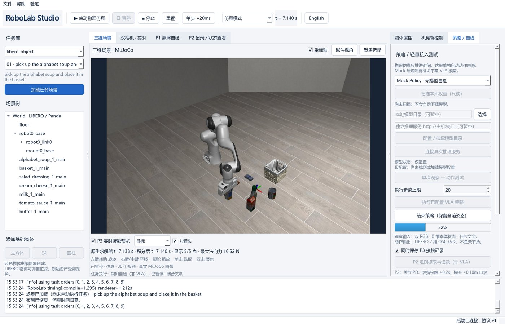
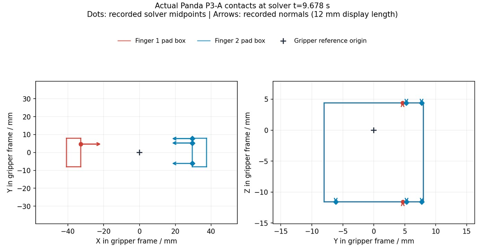
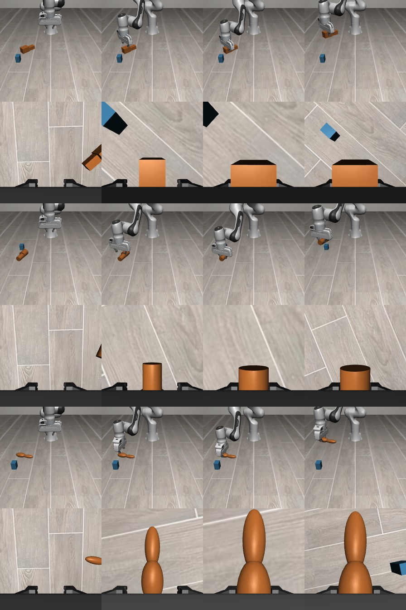
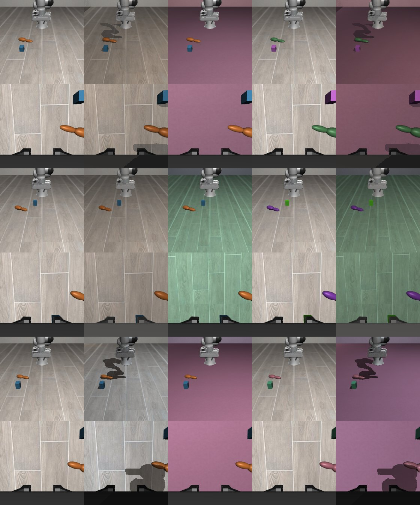
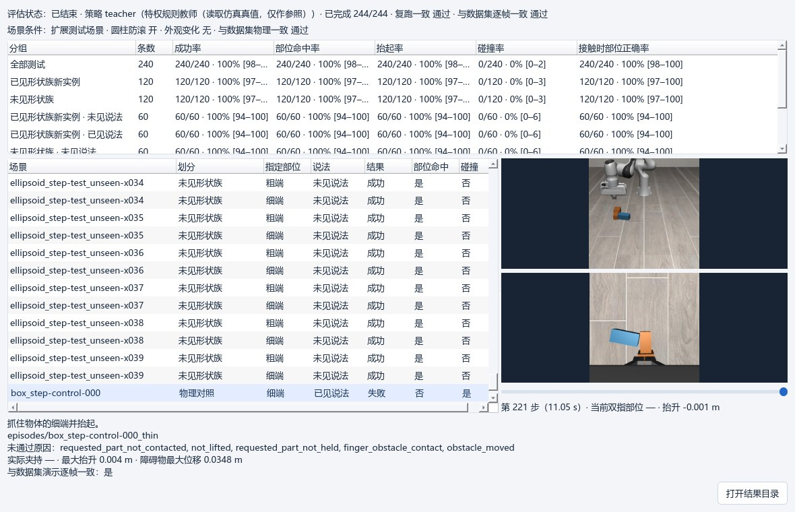
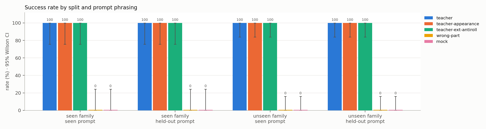

# RoboLab Studio — Codex 项目交接说明

更新时间：2026-10-31
状态：**原有 LIBERO 场景可视化成功；RoboLab Studio 桌面软件尚未开始开发。**

## 1. 项目目标

开发可从 Windows 启动的、本地运行的机器人仿真和研究工作站 **RoboLab Studio**。首期直接复用 WSL2 中已安装的 MuJoCo / robosuite / LIBERO，提供可交互 3D 视图、场景编辑、关节控制、仿真控制和项目保存。以后接入用户提供的机械臂、夹爪、相机型号与物体模型，并支持双相机、几何监督和 VLA 实验。

毕业设计方向：**Gripper-Centric Contact for Zero-Shot VLA Grasping of Unseen Objects**。研究关注对未见刚体进行指定部位抓取，并利用夹爪坐标系中的几何与指尖接触监督。π₀.₅ 是计划中的 VLA 基线；G³VLA 论文为多视角几何模块提供技术参考，不是已安装的完整软件。

## 2. 已确认的环境和进展

- 操作系统：Windows，WSL2 `Ubuntu-22.04`，Linux 用户名 `openvla`。
- GPU：NVIDIA GeForce RTX 4060 Laptop GPU，8GB 显存；WSL `nvidia-smi` 已验证 GPU 可见。大模型全量推理/训练宜放在更大显存的实验室设备上。
- Python 虚拟环境：`/home/openvla/venvs/openvla-oft`（此前使用 Python 3.10）。
- 已安装 OpenVLA-OFT 项目：`/home/openvla/projects/openvla-oft`。
- LIBERO 源码目录：`/home/openvla/projects/LIBERO`。
- 已有测试脚本：`/home/openvla/projects/test_libero_object.py`（请核对实际存在及内容）。
- **已经成功运行的可视化脚本**：`/home/openvla/projects/show_libero.py`。
- 可视化成功加载 LIBERO-Object 第一个任务：`pick up the alphabet soup and place it in the basket`。窗口标题为 `offscreen render`，画面包含机械臂、食品物体与篮子。附件 `libero_visualization_success.png` 为截图。
- 之前遇到 `ModuleNotFoundError: libero`，通过从 LIBERO 仓库目录运行并设置 `PYTHONPATH` 绕过（不代表包安装状态已彻底解决）。
- 之前 `renderer="mjviewer"` 与当前 robosuite 不兼容，报 `renderer type can only be 'nvisii' got 'mjviewer'`；改用当前可工作的 `renderer="mujoco"` 的相关配置后可以渲染。
- 之前 OpenCV Qt `xcb` 因缺 `libSM.so.6`、`libICE.so.6` 导致程序中止；安装 Ubuntu 的 `libsm6` 和 `libice6` 后已成功弹出场景。
- WSLg 图形显示：`DISPLAY=:0`、`WAYLAND_DISPLAY=wayland-0`、`/mnt/wslg/.X11-unix/X0` 存在。
- 现有界面是从相机视角显示的图像窗口，不是完整的可自由旋转 3D 场景编辑器；示例脚本以 `env.step([0.0]*7)` 执行零动作，不代表机械臂已学会抓取。

### 当前可用的启动方式（以本机脚本最终版本为准）

```bash
wsl -d Ubuntu-22.04   # 此命令在 Windows PowerShell 中执行
# 以下命令在 Ubuntu 中执行
source ~/venvs/openvla-oft/bin/activate
cd ~/projects/LIBERO
export PYTHONPATH="$PWD:${PYTHONPATH:-}"
export MUJOCO_GL=glfw
unset PYOPENGL_PLATFORM
python ~/projects/show_libero.py
```

**不要**把曾经失败的 `renderer="mjviewer"` 当作已验证的最终配置。请首先阅读本机 `show_libero.py` 原文和已安装的 robosuite 版本。

## 3. 软件功能范围及优先级

### P0：必须先交付的本地桌面 MVP

1. Windows 启动入口；WSL2 内 PySide6/Qt 主界面（若适合），GUI 与 MuJoCo 仿真进程解耦。
2. LIBERO 任务加载与列表，默认 Panda 机械臂及 `libero_object`。
3. 交互式 3D 场景视图：自由旋转、缩放、平移、坐标轴；场景树与属性检查器。
4. 仿真 Play / Pause / Stop / Reset / Step、仿真时间和日志。
5. 添加、删除、选中、平移、旋转、缩放基础物体（立方体、球、圆柱等），调整质量/摩擦/碰撞属性；明确编辑与仿真态切换。
6. 机械臂关节角滑块、夹爪开合、末端位姿显示（尊重关节限位，避免让 UI 直接写非法状态）。
7. 保存/加载场景与配置；导出截图；错误和资源释放处理。
8. 不需下载 VLA 模型权重，不破坏现有 Python 环境，不改写 LIBERO 仓库。

### P1：科研准备及可扩展建模

1. 腕部和外部双相机的同步 RGB 实时预览、深度图/分割图（如仿真支持）。
2. 虚拟相机添加、标定与相机内参 K、外参 T 导出；移动腕部相机外参实时刷新。
3. 物体模型 STL/OBJ 导入（如需 glTF，明确转换方案）；视觉网格与碰撞网格分离；参数化几何对象与物理参数。
4. 接触点、接触法线、作用力、碰撞和轨迹的可视化及数据记录。
5. 图像、机器人状态、动作、时间戳、标定参数的同步导出；保存实验种子、回放示教轨迹。

### P2：VLA 与毕业设计功能（先预留接口，不在 MVP 中硬做）

1. 可切换 OpenVLA-OFT / π₀.₅（openpi）推理适配器，支持本地或远程推理。
2. 参考 G³VLA：Ray Embedding、PRoPE、Cross-View Fusion、GT Depth 几何监督。
3. 创新模块：Gripper-Centric 几何、目标/障碍区分、左右指尖接触预测、语言指定接触区域的候选抓取选择。
4. 测量未见物体抓取成功率、指定区域抓取准确率、碰撞率、视角鲁棒性，支持消融实验。

## 4. 建议架构

- **GUI**：PySide6/Qt；场景树、属性面板、相机画面和任务配置。
- **仿真后端**：通过稳定进程接口调用 WSL 中的 MuJoCo / robosuite / LIBERO，不从 GUI 线程同步运行高频物理循环；明确图像传输与消息协议。
- **模型层**：独立的 `robot_adapter`、`camera_adapter`、`object_asset`、`policy_adapter`；可替换设备、标定参数、资产文件。
- **渲染**：先验证当前 MuJoCo/robosuite 版本的 Viewer 与离屏渲染行为，再决定 3D Viewer 的集成方式；谨防 Qt/OpenCV 插件冲突。
- **项目目录**：建议 `/home/openvla/projects/robolab-studio`；当前环境只读检查，独立新建软件开发环境，不破坏 `openvla-oft` 虚拟环境。

## 5. 给 Codex 的文件清单

### 优先提供（第一阶段真正需要）

- **`show_libero.py`**：已成功显示窗口的可运行脚本。**此文件在用户 WSL 中，当前对话并未收到源文件，需在本机访问或由用户上传。**
- **`test_libero_object.py`**：此前 LIBERO 基础测试脚本（若文件存在）。
- **`RoboLab_Codex_Handoff.md`**：本文件，项目目标和当前进度。
- **`libero_visualization_success.png`**：已成功渲染的参考截图（非必要，但能让 Codex 看到当前成果）。

### 建议提供（开发背景）

- **`EG3000_Outline_Report_3.docx`**：正式毕业设计 outline 和实验评价目标。
- **`Gripper-Centric Contact for Zero-Shot VLA Grasping of Unseen Objects.docx`**：研究方法简述。
- **`2606.24472v2 G3VLA.pdf`**：后续相机几何与几何融合的重要论文参考。
- **`2406.09246v3 OpenVLA.pdf`**：可选的 VLA 参考，不是 P0 必需。

### 无需上传完整目录；让本机 Codex 查看路径即可

- `/home/openvla/projects/LIBERO`、`/home/openvla/projects/openvla-oft`（如果 Codex 有本地 WSL 权限）。
- `/home/openvla/venvs/openvla-oft` 虚拟环境（不要打包上传）。
- `~/.libero/config.yaml`（只需检查路径配置是否有效；避免共享不必要的本机隐私信息）。
- CUDA、驱动、NVIDIA 权重、LIBERO 大型数据集，不应直接塞进 Codex 对话附件。

如果 Codex 在远程云端运行、不能访问本机 WSL，则需另行上传小型源码/配置包或把新项目代码推送 GitHub；不要假定云端有本机的 WSL 路径。

## 6. Codex 第一轮工作指令

1. 先只读检查上述脚本、包版本、GPU、WSLg、render 配置和 LIBERO 可加载性，并运行一次最小示例。
2. 在新目录建立 RoboLab Studio，写 README、环境检查脚本和启动脚本。
3. 最小验证：Windows 启动后，能够载入现有第一个 LIBERO-Object 场景、显示交互视角、切换 Play/Pause/Reset。
4. 在此基础上实现左侧场景树、右侧属性面板、基础几何编辑、一个关节滑块和截图导出。
5. 逐项给出测试命令、截图/日志、已通过和未通过项目；不要宣称未测试功能已完成。
6. 接下来再实现双 RGB 相机、相机标定与模型导入，最后开发 VLA 接口。

## 7. 明确待用户后续提供的信息

- 真实机械臂品牌/型号，URDF 或 MJCF（如果有）、自由度、关节限制。
- 末端夹爪型号、指尖几何尺寸、驱动方式和力/扭矩读数接口。
- 腕部/外部摄像头品牌型号、镜头参数、连接方式、分辨率和标定结果。
- 需要的真实对象模型、尺寸、质量、摩擦系数、纹理和指定抓取区域。

**现阶段未提供这些参数不应阻塞 MVP；使用 LIBERO 的已有 Panda 和仿真相机作默认占位。**


## 8. 同目录图片参考

以下图片使用相对于本 Markdown 文件的路径引用；移动资料时，请将本文件与图片一起移动，并保留图片文件名。请在 Markdown 预览模式中查看。

### 8.1 RoboLab Studio 主界面



### 8.2 夹爪坐标系中的接触点与法线



### 8.3 数据集物体形状示例



### 8.4 场景外观变化示例



### 8.5 P5 评估界面



### 8.6 按数据划分与提示措辞比较的成功率


