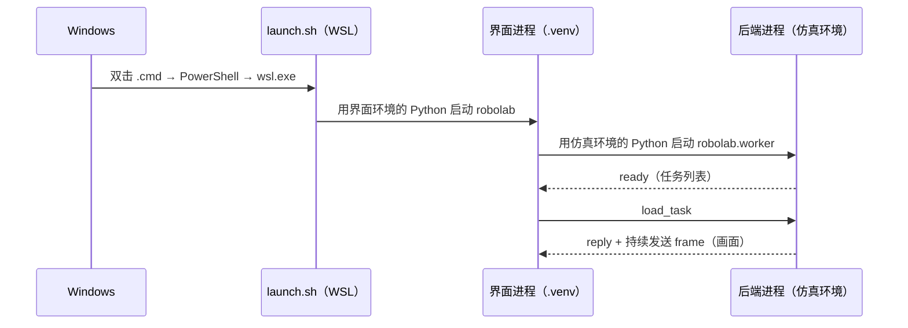
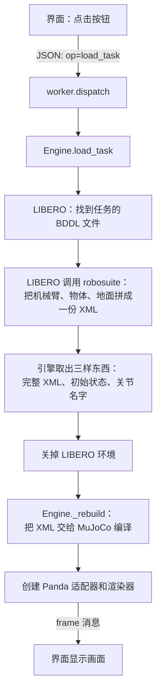
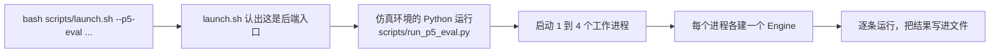
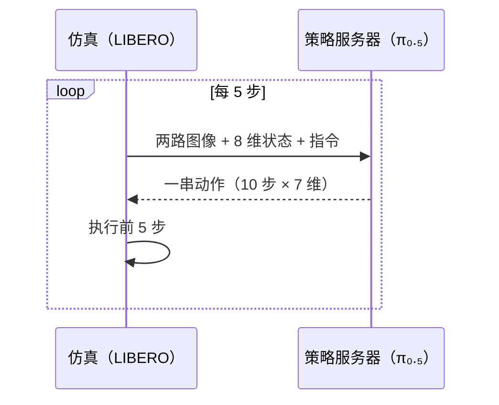
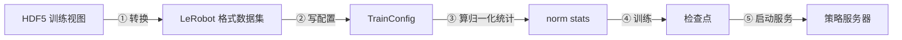
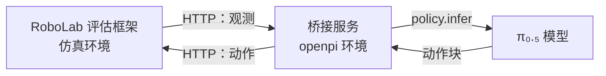
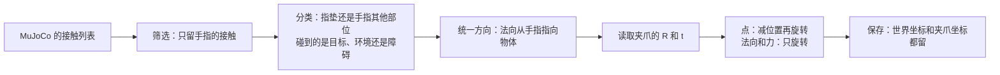
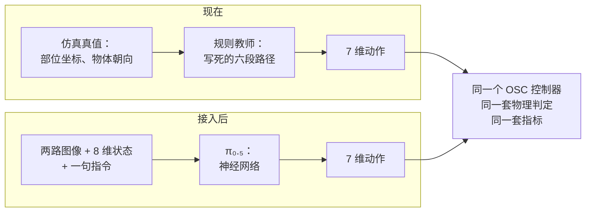
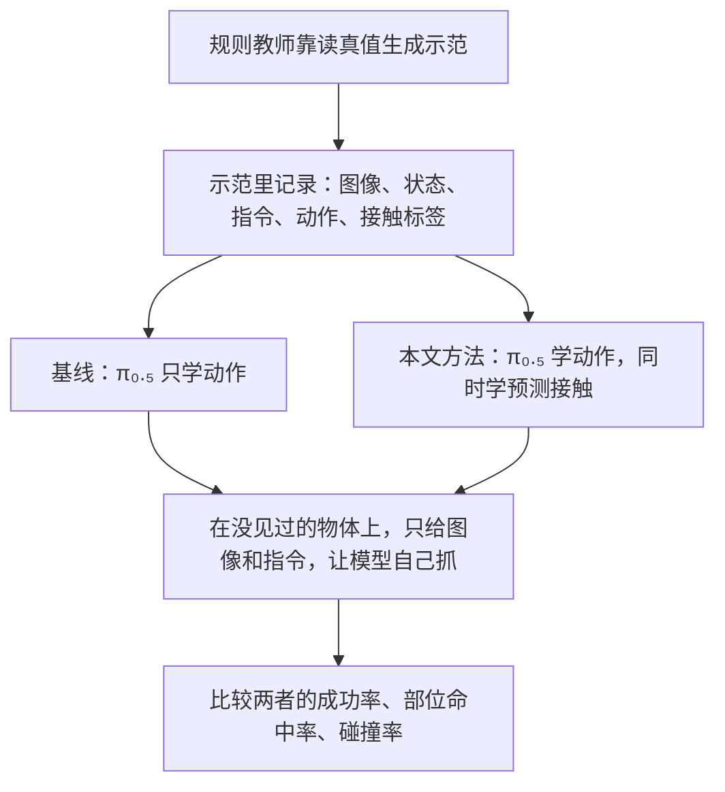

# RoboLab Studio 底层原理与 π₀.₅ 操作指南

写于 2026-11-14，2026-11-15 补充第三部分。这篇回答五个问题：

1. 这些软件是怎么装进电脑、怎么连起来的？界面怎么联系上 LIBERO 和 MuJoCo？机械臂模型从哪里来？老师给的 GitHub 仓库是什么？
2. π₀.₅ 怎么下载、怎么仿真、怎么调参数、怎么接进我们的平台？
3. 转到夹爪坐标系，具体是怎么变换的？
4. 避障是怎么实现的？自己写代码，还是靠 π₀.₅ 训练？
5. 现在没有接入 π₀.₅，抓取是怎么实现的？接入前后有什么区别？

总体介绍见同目录的 [[PROJECT_REPORT]]。

> [!warning] 哪些是核实过的，哪些不是
> - **第一部分（底层原理）** 讲的是本项目里已经在运行的代码，文件名和行号都是从代码里查出来的，行号对应 2026-11-15 的主分支 `main`。第三部分也属于这一类。
> - **第二部分（π₀.₅）** 的命令和参数，是 2026-11-14 从 openpi 官方仓库的说明和源码里查到的。**这台笔记本上没有下载过、也没有运行过 π₀.₅**，这些命令我没有实际执行过。到实验室要以当时安装的版本为准。
> - 第 18 节的“桥接服务”是设计示意，代码还没有写，也没有测试过。
> - 老师给的 Franka 仓库，我只看了它的首页说明和顶层目录，没有逐个打开子目录。

---

# 第一部分　底层原理

## 0. 先弄懂七个基础概念

后面的内容都建立在这几个概念上。

| 概念 | 通俗解释 |
| --- | --- |
| **进程** | 一个正在运行的程序。开两个进程，就像开了两个互不干扰的程序，一个崩了另一个还在 |
| **Python 环境（venv）** | 一个文件夹，里面装着一套 Python 和一批库。不同的环境互不影响。“装了某个库”的意思是：这个库的文件被放进了某个环境的文件夹里 |
| **可编辑安装** | 库的源码放在别的文件夹里，环境里只留一个“指路牌”指向它。改源码立刻生效。LIBERO 就是这样装的 |
| **标准输入 / 标准输出** | 每个进程都有一根“进水管”和一根“出水管”，可以往里写文字、从里读文字。两个进程把管子接起来就能对话 |
| **JSON** | 一种用文字表示数据的格式，比如 `{"op": "play"}`。人能读，程序也能读 |
| **XML 场景文件（MJCF）** | MuJoCo 的“图纸”。一份文本文件，写明场景里有哪些物体、怎么连接、多重、什么形状 |
| **渲染** | 根据场景的当前状态，算出一张图片。相机画面就是这样来的 |

## 1. 电脑里到底装了什么

“装软件”在这里并不神秘。没有安装向导，没有写注册表，就是**两个 Python 环境加几个源码文件夹**。

```text
Windows
└── WSL2（Windows 里的一个 Linux 子系统，Ubuntu 22.04）
    └── /home/openvla/
        ├── venvs/openvla-oft/            ← 仿真环境：一个装满库的文件夹
        │   └── lib/python3.10/site-packages/
        │       ├── mujoco/               ← 物理引擎 2.3.7
        │       ├── robosuite/            ← 机器人模型和控制器 1.4.1
        │       ├── torch/ numpy/ h5py/ … ← 其他库
        │       └── （一个指向 LIBERO 源码的“指路牌”）
        └── projects/
            ├── LIBERO/                   ← LIBERO 源码：任务、物体模型、初始状态
            ├── openvla-oft/              ← OpenVLA-OFT 源码（目前没用上）
            └── robolab-studio/           ← 我们自己的项目
                ├── .venv/                ← 界面环境：只装了界面库 PySide6
                ├── robolab/              ← 核心代码
                ├── scripts/              ← 启动脚本和批处理入口
                ├── settings/runtime.json ← 四条路径：告诉项目上面这些东西在哪
                └── outputs/              ← 数据集、评估结果、验收证据
```

可以把它想成五层，下面的被上面的调用：

| 层 | 是什么 | 作用 |
| --- | --- | --- |
| 1 | WSL2 Ubuntu | 所有东西都跑在这里面 |
| 2 | MuJoCo | 物理引擎：读一份 XML 场景文件，计算运动和接触，渲染画面 |
| 3 | robosuite | 自带 Panda 机械臂的模型文件和 OSC 控制器 |
| 4 | LIBERO | 提供任务描述、物体模型和初始状态 |
| 5 | RoboLab Studio | 我们自己的代码：界面、接触采样、数据集、评估 |

**为什么要两个环境？** 界面库（PySide6）和仿真环境里已有的一些库会冲突。把界面单独放进 `.venv`，就不用往仿真环境里装任何新东西，原来能跑的仿真不会被弄坏。

**项目怎么知道东西在哪？** `settings/runtime.json` 里写着四条路径：

```json
{
  "backend_python": "~/venvs/openvla-oft/bin/python",
  "libero_root": "~/projects/LIBERO",
  "libero_config_path": "settings/libero",
  "oft_root": "~/projects/openvla-oft"
}
```

读取这个文件的代码在 `robolab/config.py`。优先级是：环境变量 → 这个文件 → 自动猜测常见位置。到实验室换了路径，只要改这个文件，代码不用动。

## 2. 三个库各自负责什么

很多困惑来自分不清 MuJoCo、robosuite 和 LIBERO。它们是一层套一层的关系：

- **LIBERO** 回答：场景里有什么、任务是什么。
- **robosuite** 回答：机械臂长什么样、怎么控制。
- **MuJoCo** 回答：下一个时刻每个东西在哪里、受多大的力。

看一下它们各自的“原材料”长什么样，就清楚了。

**LIBERO 的任务文件**是一种叫 BDDL 的文本。默认任务“把字母汤罐头放进篮子”的文件开头是这样的：

```text
(define (problem LIBERO_Floor_Manipulation)
  (:domain robosuite)
  (:language Pick the alphabet soup and place it in the basket)
    (:regions
      (bin_region
          (:target floor)
          (:ranges ((-0.01 0.25 0.01 0.27)))
      )
      (target_object_region
          (:target floor)
          (:ranges ((-0.145 -0.265 -0.095 -0.215)))
      )
      ...
```

它写明了：指令是什么、篮子放在地面的哪个范围、目标物体放在哪个范围。文件在 `~/projects/LIBERO/libero/libero/bddl_files/libero_object/` 里。

**robosuite 的机械臂文件**是 MuJoCo 的 XML，见第 7 节。

**robosuite 的控制器配置**是一个小 JSON 文件 `osc_pose.json`，其中最要紧的是这两行：

```json
"output_max": [0.05, 0.05, 0.05, 0.5, 0.5, 0.5],
"control_delta": true,
```

意思是：归一化动作里的 1，对应末端移动 0.05 米或转动 0.5 弧度；动作是“增量”，不是绝对位置。数据集里 7 维动作的含义就来自这个文件。

**MuJoCo** 不自带任何机器人或任务。它只做一件事：你给它一份 XML，它负责算物理和画图。

## 3. 从双击图标到看见画面



分步说：

1. 双击 `Launch RoboLab Studio.cmd`。它只有一行，作用是调用 `Start-RoboLab.ps1`。
2. `Start-RoboLab.ps1` 执行 `wsl.exe`，进入 Ubuntu，运行项目里的 `scripts/launch.sh`。
3. `launch.sh` 先执行 `scripts/runtime.sh` 把路径设置好，再用**界面环境**的 Python 运行 `python -m robolab`。入口是 `robolab/__main__.py`，它创建主窗口，窗口出现。
4. 主窗口创建时会新建一个 `BackendClient`（`robolab/gui.py` 第 150 行）。它用**仿真环境**的 Python 另外启动一个进程（`robolab/client.py` 第 36 行）：

```python
self.process.start(str(BACKEND_PYTHON), ['-m', 'robolab.worker'])
```

到这一步，电脑上有两个 Python 进程：

| | 界面进程 | 后端进程 |
| --- | --- | --- |
| 用哪个 Python | 项目里的 `.venv` | `~/venvs/openvla-oft` |
| 运行什么 | `robolab`（`gui.py`） | `robolab.worker` |
| 导入了什么 | 只有 PySide6 | MuJoCo、robosuite、LIBERO、NumPy |
| 负责什么 | 画窗口、响应鼠标 | 物理仿真、渲染、接触采样 |

界面进程里**完全没有** MuJoCo。`client.py` 开头的注释写的就是这条规则：“No simulation dependency is imported in the GUI.”

## 4. 界面和仿真是怎么对话的

两个进程之间靠**一行一行的 JSON 文字**通信。界面往后端的“进水管”里写，后端往“出水管”里写，界面再读出来。

**界面 → 后端**，是命令。`robolab/client.py` 第 38 行的 `send`：

```python
def send(self, op, **args):
    self.sequence += 1
    self.process.write((json.dumps({'id': self.sequence, 'op': op, 'args': args})+'\n').encode())
```

写出去的一行大致是：

```json
{"id": 3, "op": "load_task", "args": {"suite": "libero_object", "index": 0}}
```

**后端 → 界面**，有几种消息。`robolab/worker.py` 第 19 行的 `emit` 负责发送：

| 消息 | 什么时候发 | 内容 |
| --- | --- | --- |
| `ready` | 后端启动完成 | 任务列表、可用的策略适配器 |
| `reply` | 每条命令执行完 | 成功或失败、返回值、当前状态 |
| `frame` | 每秒约 15 次 | 三维场景的一张图片（JPEG 转成文字）和当前状态 |
| `camera_frame` | 打开双相机预览时，每 0.2 秒一次 | 两路相机的图片 |
| `busy` | 开始执行耗时的命令 | 告诉界面“正在忙” |
| `fault` | 出错 | 错误信息 |

后端认识的命令（`op`）有几十个，都列在 `worker.py` 第 36 行的 `dispatch` 函数里。它就是一个“总机”，按命令的名字转给引擎的对应函数：

```python
if op == 'load_task': return engine.load_task(...)
if op == 'play': engine.play()
elif op == 'pause': engine.pause()
elif op == 'step': engine.pause(); engine.step()
elif op == 'joint': engine.set_joint(args['index'], args['radians'])
elif op == 'jog_xyz': return engine.jog_xyz(args['delta'], ...)
...
```

所以界面上的每一个按钮，背后都对应一个 `op`。想知道某个按钮做了什么，在 `gui.py` 里找它发出的 `op`，再到 `dispatch` 里找对应的引擎函数。

> [!note] 你在界面上看到的“三维场景”其实是图片
> 中间那个可以旋转的三维视图，并不是界面自己画的三维模型，而是后端渲染好的一张张图片。鼠标拖动旋转视角时，界面发一条命令给后端，后端换个角度再渲染一张发回来。

## 5. 点一下“加载任务场景”，背后发生了什么

这是理解“界面怎么联系上 LIBERO 和 MuJoCo”的最好例子。



关键代码在 `robolab/engine.py` 第 97 行的 `load_task`。去掉检查之后，核心是这几行：

```python
suite = benchmark.get_benchmark_dict()[suite_name]()        # LIBERO：取任务集
task = suite.get_task(index)                                # 取第 index 个任务
states = suite.get_task_init_states(index)                  # 取官方的初始状态
env = ControlEnv(bddl_file_name=..., ...)                   # LIBERO 创建环境（内部调用 robosuite）
env.env.reset()
env.set_init_state(states[init_index])

robot = env.robots[0]
meta = (list(robot.robot_model.joints),                     # 7 个手臂关节的名字
        list(robot.gripper.joints),                         # 2 个手指关节的名字
        native.site(robot.eef_site_id).name)                # 末端参考点的名字
base_xml = env.sim.model.get_xml()                          # ★ 取出完整的场景 XML
qpos, qvel = env.sim.data.qpos.copy(), env.sim.data.qvel.copy()
env.close()                                                 # 用完就关掉 LIBERO 环境
```

然后在第 180 行的 `_rebuild` 里：

```python
model = mujoco.MjModel.from_xml_string(xml)   # ★ 把 XML 交给 MuJoCo
data = mujoco.MjData(model)
```

**这里有一个重要的设计：我们只向 LIBERO “借图纸”。** LIBERO 负责把场景拼出来；拼好之后，引擎把图纸（XML）拿走，自己直接和 MuJoCo 打交道。这样做的好处是：

- 可以随意改图纸。P4 的双部位物体、障碍物、防滚设置，都是在这份 XML 上修改得到的。
- 能精确控制每一个物理子步，这是接触采样需要的。
- 不受 LIBERO 环境内部逻辑的限制，比如它的自动重置。

## 6. 物理是怎么往前走的

后端的主循环在 `robolab/worker.py` 第 92 行的 `main` 函数里，一直在转，每一圈做四件事：

1. **处理命令**：从队列里取出界面发来的命令，逐条执行。
2. **推进物理**：如果处于“运行”状态，按真实流逝的时间调用 `engine.step()`。每调用一次，仿真前进 20 毫秒。
3. **发画面**：到时间了就渲染一张图发给界面。
4. **休息 3 毫秒**，再转下一圈。

`engine.step()`（`engine.py` 第 274 行）里面的结构是：

```python
steps = round(0.02 / dt)          # 20 毫秒 ÷ 2 毫秒 = 10 个子步
for index in range(steps):
    self.robot.apply_control(dt)  # 算出每个关节该施加多大的力矩
    mujoco.mj_step(model, data)   # MuJoCo 前进一个 2 毫秒的子步
```

`mj_step` 是 MuJoCo 最核心的函数。调用一次，它做三件事：检测哪些物体碰在一起，求解接触力，更新所有物体的位置和速度。

> [!note] 两种“时间粒度”
> - 界面手动操作、P2 和 P3 用的是 **20 毫秒**的控制周期（10 个子步）。
> - 数据集和评估用的是 **50 毫秒**的控制周期（25 个子步），因为这是 LIBERO 和 VLA 模型的标准频率（每秒 20 次）。
>
> 两者的子步都是 2 毫秒，物理精度相同。

## 7. 机械臂模型：从哪来、长什么样、软件怎么认出它

### 7.1 从哪来

仿真里的 Panda 来自 **robosuite 自带的模型文件**，不是老师给的仓库。它在仿真环境里：

```text
~/venvs/openvla-oft/lib/python3.10/site-packages/robosuite/models/assets/
├── robots/panda/
│   ├── robot.xml          ← 手臂：252 行的文本
│   └── meshes/            ← 各个连杆的三维网格
└── grippers/
    └── panda_gripper.xml  ← 夹爪
```

### 7.2 长什么样

`robot.xml` 的结构是一层套一层的“连杆—关节”。下面是摘出来的几行：

```xml
<actuator>
    <motor ctrlrange="-80.0 80.0" joint="joint1" name="torq_j1"/>
    ...
</actuator>

<body name="link0">
    <body name="link1" pos="0 0 0.333">
        <joint name="joint1" axis="0 0 1" range="-2.8973 2.8973" damping="0.1"/>
        <body name="link2" ...>
            <joint name="joint2" axis="0 0 1" range="-1.7628 1.7628"/>
            ...
```

读法：

| 标签 | 含义 | 例子 |
| --- | --- | --- |
| `body` | 一个连杆。嵌套表示“挂在上一个连杆上” | `link1` 在 `link0` 上方 0.333 米处 |
| `joint` | 关节：转轴方向和角度范围 | `joint1` 绕 z 轴转，范围 ±2.8973 弧度 |
| `geom` | 连杆的形状，分为显示用的和碰撞用的 | 引用 `meshes/` 里的网格文件 |
| `motor` | 电机：作用在哪个关节上，力矩上限多少 | `joint1` 最大 ±80 牛·米 |
| `site` | 一个没有质量的参考点 | 夹爪中心 `grip_site` |
| `camera` | 相机 | 腕部相机 `eye_in_hand`，视场角 75 度 |

夹爪文件里，每根手指的指尖有一个 16×8×16 毫米的小方块，这就是“指垫”的碰撞体。接触采样识别“是不是指垫碰到了物体”，靠的就是它。

robosuite 把手臂、夹爪和场景拼在一起时，会给名字加前缀，所以最终的名字是 `robot0_joint1`、`gripper0_finger1_pad_collision`、`robot0_eye_in_hand` 这样的。

### 7.3 软件怎么“认出”它

**MuJoCo 并不知道“这是一台 Panda”。** 它只看到一堆有名字的连杆、关节和形状。我们的软件靠**名字**找到机械臂的各个部分：

1. 加载任务时，从 robosuite 取出关节名列表、夹爪关节名、末端参考点的名字（上面第 5 节代码里的 `meta`）。
2. `PandaJointAdapter`（`robolab/adapters.py` 第 49 行）用这些名字到 MuJoCo 的模型里查编号：

```python
self.jids = [model.joint(n).id for n in joint_names]   # 名字 → 关节编号
self.qadr = model.jnt_qposadr[self.jids]               # 关节编号 → 它的角度存在数组的哪个位置
```

3. 之后读关节角度就是 `data.qpos[self.qadr]`，发力矩就是往 `data.ctrl` 里写。

其他部分也是靠名字：

| 要找的东西 | 用的名字 | 在哪里用 |
| --- | --- | --- |
| 两个指垫 | `gripper0_finger1_pad_collision`、`gripper0_finger2_pad_collision` | 接触采样（P3） |
| 夹爪坐标系 | `gripper0_grip_site` | 坐标转换（P3） |
| 外部相机 | `agentview`（定义在 LIBERO 的场景文件里） | 渲染 |
| 腕部相机 | `robot0_eye_in_hand`（定义在 `robot.xml` 里） | 渲染 |
| 目标物体的两段 | `p4_stepped_bar_thick`、`p4_stepped_bar_thin` | 部位判定（P4） |

如果换一台机器人，名字不一样，就需要写一个新的适配器。`adapters.py` 末尾的 `create_robot_adapter` 就是按名字选择适配器的入口。

## 8. 两种控制方式

项目里先后用了两种让机械臂动起来的方式，容易混淆：

| | 关节 PD 控制 | OSC 控制 |
| --- | --- | --- |
| 你给它什么 | 7 个关节的目标角度 | 末端往哪移多少、转多少（7 维归一化动作） |
| 谁写的 | 我们自己写的 `PandaJointAdapter` | robosuite 原版的 `OSC_POSE` 控制器 |
| 代码在哪 | `robolab/adapters.py` | `robolab/p4_osc.py` 调用 robosuite |
| 用在哪 | 界面上手动控制、P2 规则抓取、P3、P4-A/B | P4-C 之后的数据集、P5 评估 |
| 和 VLA 模型的关系 | 不兼容 | 与 LIBERO 和 openpi 完全一致 |

`robolab/p4_osc.py` 里的 `SyntheticOsc` 类（第 24 行）做的事是：把 robosuite 的机械臂对象和 OSC 控制器“装”到我们自己编译的场景上。它的 `step` 函数就是数据集和评估里每一个 50 毫秒周期的执行过程：

```python
for substep in range(self.substeps):                      # 25 个子步
    self.sim.forward()
    self.robot.control(action, policy_step=substep == 0)  # robosuite 原版控制器算力矩
    if substep == 0:
        before = self.engine.contact_sampler.prepare()    # 第一个子步前：准备采样
    self.sim.step()                                       # MuJoCo 前进 2 毫秒
    if substep == 0:
        self.engine.contact_sampler.capture(before, ...)  # 第一个子步后：读出接触
```

## 9. 老师给的 Franka 仓库

仓库地址：<https://github.com/frankarobotics/franka_description>

> [!important] 现状
> **这个仓库目前没有导入项目，电脑上也没有下载它。** 我们只在硬件记录文档（`docs/HARDWARE_PROFILE.md`）里把它登记为“模型来源”。

### 9.1 它是什么

它是 Franka 公司官方的**机器人描述库**，不是仿真器。按它首页的说明：

- 它提供 Franka 各型号机器人的三维模型和参数，并且能为选定的型号生成 URDF 文件。
- 支持的型号有 `fer`、`fr3`、`fp3`、`fr3v2`、`fr3v2_1`、`fr3_duo` 等。**`fer` 就是实验室的 Panda**（Franka Emika Robot 的缩写）。
- 首页明确写着：**`fer` 型号已不再维护**。文件还在，也能生成，但报告的问题不会修，官方建议改用 `fr3` 或 `fp3`。
- 顶层目录有 `robots`、`end_effectors`、`meshes`、`accessories`、`launch`、`rviz`、`scripts`、`test`。
- 开源协议是 Apache 2.0。

### 9.2 URDF 是什么，和 MuJoCo 的 XML 有什么关系

URDF 是机器人领域通用的模型格式，也是一种 XML。它描述的内容和第 7 节的 MuJoCo XML 是**同一类信息**：连杆、关节、形状、质量。区别在于给谁用：

| | URDF | MuJoCo XML（MJCF） |
| --- | --- | --- |
| 主要用户 | ROS 生态：运动规划、可视化、真机控制器 | MuJoCo 物理引擎 |
| 包含什么 | 运动学、惯性、形状 | 以上全部，再加电机、接触参数、相机、传感器 |
| 我们的仿真用哪个 | 不用 | 用 |

### 9.3 它怎么用

这个仓库里存的不是能直接用的模型，而是模板（一种叫 xacro 的带参数的 XML）。要用的时候运行脚本，生成一份具体的 URDF。按它首页的说明，命令是：

```bash
./scripts/create_urdf.sh fer
```

需要安装 Docker，并且要在仓库的根目录下运行。可以加参数，比如 `--robot-ee franka_hand` 指定带原装夹爪，`--abs-path` 使用绝对路径。

它还能在 ROS 里可视化：

```bash
./scripts/visualize_franka.sh robot_type:=fer
```

### 9.4 为什么仿真里没有用它

- robosuite 自带的 Panda，和这个仓库里的 `fer` 描述的是**同一台机器人**，而且已经配好了电机、控制器和相机。
- LIBERO、openpi 的 LIBERO 例子、官方的 π₀.₅ 权重，全都建立在 robosuite 的这个模型上。如果换掉模型，就和它们对不上了，官方权重也不能直接用。
- 把 URDF 换进 MuJoCo 不是“导入”一下那么简单：要转换格式、补上电机和接触参数、重新配置控制器，再重新验证所有结果。

### 9.5 它在什么时候用得上

在**真机阶段**：

- 真机的控制程序需要它来做运动学计算（从关节角算末端位置，或者反过来）。
- 需要从它里面查真机的末端坐标系定义，和仿真里的夹爪坐标系对齐。
- 核对真机的关节范围、夹爪开合范围是否和仿真里一致。
- 如果实验室的夹爪或安装方式和仿真不同，要以它为准去修改仿真模型。

> [!question] 建议向老师确认
> 老师给这个仓库，是用于**真机**，还是也要求**仿真**里用它的模型？
> - 如果只是真机：现在的做法没有问题。
> - 如果要求仿真也用：需要做 9.4 里说的转换工作，并且会失去和 LIBERO、官方权重的一致性。这是一个需要权衡的决定。

## 10. 数据集和评估不经过界面

采集数据集、跑评估这些批量任务，是在命令行里直接用仿真环境的 Python 运行脚本，没有界面进程，也不发画面消息。



`scripts/launch.sh` 的开头有一段判断：`--p4d-dataset`、`--p5-eval` 这类选项，直接交给仿真环境的 Python；其他情况才启动界面。

批处理和界面用的是**同一个 `Engine` 类**，所以界面上看到的物理和数据集里的物理是同一套代码。界面只在最后用来打开结果文件查看。

## 11. 想自己读代码，从哪里开始

建议按这个顺序读，每个文件都不长：

|  顺序 | 文件                                                  |    行数 | 读它能明白什么         |
| --: | --------------------------------------------------- | ----: | --------------- |
|   1 | `scripts/launch.sh`                                 |  约 45 | 各个命令行入口分别启动了什么  |
|   2 | `robolab/config.py`                                 |  约 55 | 路径是怎么确定的        |
|   3 | `robolab/client.py`                                 |    84 | 界面怎么启动后端、怎么收发消息 |
|   4 | `robolab/worker.py`                                 |   192 | 后端的主循环和命令总机     |
|   5 | `robolab/engine.py` 的 `load_task`、`_rebuild`、`step` | 约 150 | 场景怎么加载、物理怎么推进   |
|   6 | `robolab/adapters.py` 的 `PandaJointAdapter`         | 约 150 | 怎么靠名字找到机械臂并控制它  |
|   7 | `robolab/p4_osc.py`                                 |    93 | OSC 动作怎么执行      |
|   8 | `robolab/p3_contact.py`                             |   212 | 接触怎么读出来、怎么分类    |
|   9 | `robolab/p5_eval.py` 的 `run_eval_episode`           |  约 90 | 一条评估从头到尾的流程     |

---

# 第二部分　π₀.₅ 操作指南

## 12. π₀.₅ 是什么形式

π₀.₅ 不是一个能双击的软件。它由两样东西组成：

- **代码**：GitHub 上的 `openpi` 仓库（<https://github.com/Physical-Intelligence/openpi>）。里面有模型结构、训练脚本、推理服务。
- **权重**：训练好的参数文件，放在谷歌云存储上，几十 GB。

openpi 提供的权重里，和我们有关的是这几份：

| 名称 | 存放位置 | 用途 |
| --- | --- | --- |
| π₀.₅ 基础权重 | `gs://openpi-assets/checkpoints/pi05_base` | 微调时从它出发 |
| π₀.₅-LIBERO | `gs://openpi-assets/checkpoints/pi05_libero` | 官方在 LIBERO 上微调好的，可以直接推理 |
| π₀.₅-DROID | `gs://openpi-assets/checkpoints/pi05_droid` | 在真实 Franka 数据集 DROID 上微调的，真机阶段可以参考 |
| π₀ 基础权重 | `gs://openpi-assets/checkpoints/pi0_base` | 上一代模型，有现成的省显存配置 |

官方公布的 π₀.₅-LIBERO 成绩（训练 3 万步）：

| LIBERO Spatial | LIBERO Object | LIBERO Goal | LIBERO 10 | 平均 |
| ---: | ---: | ---: | ---: | ---: |
| 98.8 | 98.2 | 98.0 | 92.4 | 96.85 |

## 13. 硬件要求

官方说明里的表格：

| 用途 | 显存 | 举例 |
| --- | --- | --- |
| 推理 | 8 GB 以上 | RTX 4090 |
| LoRA 微调 | 22.5 GB 以上 | RTX 4090 |
| 全量微调 | 70 GB 以上 | A100（80 GB）、H100 |

- 官方只在 **Ubuntu 22.04** 上测试过。
- 可以用多块显卡分担一个模型（训练配置里的 `fsdp_devices`），不支持多台机器。

> [!warning] 关于 LoRA 的一个细节
> openpi 自带的 LoRA 配置（`pi0_libero_low_mem_finetune`）是给 **π₀** 的。**π₀.₅ 的 LIBERO 配置没有 LoRA 版本**，它是全量微调，批量大小 256。
>
> 如果实验室的显卡在 24 到 48 GB 之间，想微调 π₀.₅，就需要参照 π₀ 的那份省显存配置，自己写一个 π₀.₅ 的 LoRA 配置。能不能正常训练，要到实验室实测。

笔记本的 8 GB 显存，理论上刚好在推理的门槛上，但同时还要跑仿真，不现实。所以 π₀.₅ 的所有操作都放在实验室。

## 14. 安装与下载

### 14.1 装代码

```bash
git clone --recurse-submodules git@github.com:Physical-Intelligence/openpi.git
```

```bash
cd openpi
```

openpi 用一个叫 `uv` 的工具管理 Python 环境（安装方法见 <https://docs.astral.sh/uv/>）。装依赖：

```bash
GIT_LFS_SKIP_SMUDGE=1 uv sync
```

```bash
GIT_LFS_SKIP_SMUDGE=1 uv pip install -e .
```

`uv` 会在 openpi 的文件夹里建一个**独立的** Python 环境。它不会碰我们仿真用的环境，这正是我们想要的。

### 14.2 下载权重

**不需要手动下载。** 第一次用到某个权重时，程序会自动从 `gs://openpi-assets/` 拉取，缓存到 `~/.cache/openpi`。

- 想换存放位置：设置环境变量 `OPENPI_DATA_HOME`。
- 实验室的机器要能访问谷歌云存储。如果不能联网，就需要在别的机器上下好再拷过去。

也可以在代码里主动触发下载：

```python
from openpi.shared import download
checkpoint_dir = download.maybe_download("gs://openpi-assets/checkpoints/pi05_libero")
```

## 15. 跑官方的 LIBERO 仿真

openpi 的做法和我们的平台思路一样：**模型和仿真分成两个进程**。模型作为“策略服务器”运行，仿真作为客户端向它要动作。



### 15.1 方式一：两个终端

终端一，启动模型服务。默认监听 8000 端口，自动下载并加载 `pi05_libero`：

```bash
uv run scripts/serve_policy.py --env LIBERO
```

终端二，跑 LIBERO 仿真。它需要一个单独的 Python 3.8 环境：

```bash
uv venv --python 3.8 examples/libero/.venv
```

```bash
source examples/libero/.venv/bin/activate
```

```bash
uv pip sync examples/libero/requirements.txt third_party/libero/requirements.txt --extra-index-url https://download.pytorch.org/whl/cu113 --index-strategy=unsafe-best-match
```

```bash
uv pip install -e packages/openpi-client && uv pip install -e third_party/libero
```

```bash
export PYTHONPATH=$PYTHONPATH:$PWD/third_party/libero
```

```bash
python examples/libero/main.py
```

### 15.2 方式二：Docker（官方推荐）

```bash
sudo xhost +local:docker
```

```bash
SERVER_ARGS="--env LIBERO" docker compose -f examples/libero/compose.yml up --build
```

如果报 EGL 相关的错误，在前面加上 `MUJOCO_GL=glx`。

### 15.3 仿真那一侧每一步做了什么

`examples/libero/main.py` 里的循环，和我们评估框架做的事几乎一样：

1. 开头先空等 10 步，让物体落稳。
2. 从仿真取两路图像（256×256），**旋转 180 度**，缩放到 224×224。
3. 拼出 8 维状态：末端位置 3 维 + 轴角 3 维 + 夹爪 2 维。
4. 把四项内容发给服务器：

```python
element = {
    "observation/image": img,
    "observation/wrist_image": wrist_img,
    "observation/state": state,
    "prompt": str(task_description),
}
action_chunk = client.infer(element)["actions"]
```

5. 服务器返回一串动作。仿真只执行前 5 步，然后重新请求。

这个脚本的主要参数：

| 参数 | 默认值 | 含义 |
| --- | --- | --- |
| `host` / `port` | `0.0.0.0` / `8000` | 策略服务器的地址 |
| `resize_size` | 224 | 图像尺寸 |
| `replan_steps` | 5 | 每串动作执行几步后重新推理 |
| `task_suite_name` | `libero_spatial` | 评哪个任务集，可选 `libero_object`、`libero_goal`、`libero_10`、`libero_90` |
| `num_steps_wait` | 10 | 开头空等的步数 |
| `num_trials_per_task` | 50 | 每个任务跑多少次 |
| `seed` | 7 | 随机种子 |

> [!tip] 到实验室的第一件事
> 先把这个官方例子跑通，看成功率是否接近官方公布的 96.85%。这一步和我们的研究任务无关，但它能证明：openpi 装对了、权重完好、推理正常。之后在我们自己的任务上出了问题，就可以排除“环境没装好”这个可能。

## 16. 怎么调参数

参数分三类，改的地方不一样。

### 16.1 训练参数

都在 `src/openpi/training/config.py` 里。每一套训练设置是一个有名字的 `TrainConfig`。官方的 `pi05_libero` 是这样写的：

```python
TrainConfig(
    name="pi05_libero",
    model=pi0_config.Pi0Config(pi05=True, action_horizon=10, discrete_state_input=False),
    data=LeRobotLiberoDataConfig(
        repo_id="physical-intelligence/libero",
        base_config=DataConfig(prompt_from_task=True),
        extra_delta_transform=False,
    ),
    batch_size=256,
    lr_schedule=_optimizer.CosineDecaySchedule(
        warmup_steps=10_000,
        peak_lr=5e-5,
        decay_steps=1_000_000,
        decay_lr=5e-5,
    ),
    optimizer=_optimizer.AdamW(clip_gradient_norm=1.0),
    ema_decay=0.999,
    weight_loader=weight_loaders.CheckpointWeightLoader("gs://openpi-assets/checkpoints/pi05_base/params"),
    num_train_steps=30_000,
),
```

逐项解释：

| 参数 | 这里的取值 | 含义 | 什么时候改 |
| --- | --- | --- | --- |
| `name` | `pi05_libero` | 这套配置的名字，命令行里用它 | 新建配置时起一个新名字 |
| `model` → `pi05=True` | — | 用 π₀.₅ 的结构 | 不改 |
| `model` → `action_horizon` | 10 | 模型一次预测多少步动作 | 一般不改 |
| `data` → `repo_id` | 官方的 LIBERO 数据集 | 用哪个数据集训练 | **换成我们自己的数据集** |
| `data` → `prompt_from_task` | True | 用数据集里的任务描述当指令 | 不改 |
| `data` → `extra_delta_transform` | False | 是否再做一次“绝对→增量”的转换。LIBERO 的动作已经是增量 | 不改，我们的动作也是增量 |
| `batch_size` | 256 | 一次训练用多少帧 | 显存不够就调小 |
| `lr_schedule` → `peak_lr` | 5e-5 | 学习率 | 一般不改；训练不稳定时调小 |
| `lr_schedule` → `warmup_steps` | 10,000 | 学习率从 0 升到峰值用多少步 | 总步数少时相应调小 |
| `num_train_steps` | 30,000 | 总训练步数 | 数据少时可以减少 |
| `ema_decay` | 0.999 | 权重的滑动平均 | 显存不够时设为 `None` 关掉 |
| `weight_loader` | 从 `pi05_base` 加载 | 从哪份权重出发 | 不改 |

`TrainConfig` 还有一些没在这里写出来、用默认值的参数：

| 参数 | 默认值 | 含义 |
| --- | --- | --- |
| `seed` | 42 | 随机种子。要跑多个种子时改它 |
| `save_interval` | 1000 | 每多少步存一次检查点 |
| `keep_period` | 5000 | 步数是它整数倍的检查点不会被删 |
| `log_interval` | 100 | 每多少步记一次日志 |
| `num_workers` | 2 | 读数据的进程数 |
| `fsdp_devices` | 1 | 把模型分到几块显卡上 |
| `wandb_enabled` | True | 是否用 wandb 记录训练曲线 |
| `freeze_filter` | 不冻结 | 冻结哪些权重。LoRA 配置会用到 |

### 16.2 推理参数

在仿真客户端那一侧：

- `replan_steps`：每串动作执行几步后重新推理。对应我们评估命令里的 `--execute-steps`。**训练和评估要保持一致。**
- 图像尺寸和方向。
- 指令文字。

### 16.3 省显存的办法

按官方说明，显存不够时依次尝试：

1. 训练命令前加 `XLA_PYTHON_CLIENT_MEM_FRACTION=0.9`，允许程序使用 90% 的显存（默认 75%）。
2. 训练命令加 `--fsdp-devices <显卡数>`，把模型分到多块显卡上。
3. 把 `ema_decay` 设为 `None`。
4. 调小 `batch_size`。
5. 用 LoRA（见第 13 节的提醒）。

openpi 也提供 PyTorch 版本的 π₀.₅，但它不支持 LoRA 训练，也不支持多卡分担模型，所以省显存主要靠默认的 JAX 版本。

## 17. 用我们的数据训练

整个流程是五步：



**① 转换数据。** openpi 有一个现成的例子 `examples/libero/convert_libero_data_to_lerobot.py`。照着它写一个我们自己的版本，数据来源换成我们的读取函数：

```python
from robolab.p4_dataset_export import iter_policy_frames

for frame in iter_policy_frames("export/p4_osc_train.hdf5", language="en",
                                image_convention="libero_rotated_180"):
    dataset.add_frame(frame)   # 字段：image, wrist_image, state, actions, task
```

我们的读取函数给出的字段名，是特意按 openpi 的例子对齐的。

**② 写配置。** 在 `config.py` 里复制 `pi05_libero` 那一段，改两处：

```python
TrainConfig(
    name="pi05_partgrasp",                      # ← 新名字
    model=pi0_config.Pi0Config(pi05=True, action_horizon=10, discrete_state_input=False),
    data=LeRobotLiberoDataConfig(
        repo_id="<我们转换出的数据集名>",          # ← 换成我们的数据
        base_config=DataConfig(prompt_from_task=True),
        extra_delta_transform=False,
    ),
    # 其余和 pi05_libero 相同；batch_size 按显存调整
    ...
),
```

> [!note]
> 这段是照着官方配置改的示意，没有运行过。

**③ 算归一化统计。**

```bash
uv run scripts/compute_norm_stats.py --config-name pi05_partgrasp
```

**④ 训练。**

```bash
XLA_PYTHON_CLIENT_MEM_FRACTION=0.9 uv run scripts/train.py pi05_partgrasp --exp-name=baseline_seed42 --overwrite
```

检查点会存到 `checkpoints/pi05_partgrasp/baseline_seed42/<步数>/`。

**⑤ 用训练好的检查点启动服务。**

```bash
uv run scripts/serve_policy.py policy:checkpoint --policy.config=pi05_partgrasp --policy.dir=checkpoints/pi05_partgrasp/baseline_seed42/20000
```

## 18. 接入 RoboLab Studio

### 18.1 为什么需要一个桥接服务

我们的评估框架和 openpi 的策略服务器说的是两种“语言”：

| | 我们的评估框架 | openpi 的策略服务器 |
| --- | --- | --- |
| 通信方式 | HTTP：`GET /health`、`POST /predict` | WebSocket |
| 观测的字段名 | `images`、`proprio`、`instruction` | `observation/image`、`observation/wrist_image`、`observation/state`、`prompt` |
| 图像 | JPEG 转成文字，规范方向 | 数组，LIBERO 约定是旋转 180 度 |

所以中间要有一个小程序做翻译，叫**桥接服务**。它运行在 openpi 的环境里。



### 18.2 桥接服务要做的事

我们这边对服务的要求，写在 `robolab/policy.py` 的 `HttpPolicy` 类（第 195 行）里：

**`GET /health` 要返回：**

```json
{"service": "robolab-vla", "protocol": 1, "action_space": "libero_osc_7d",
 "family": "pi05", "model_loaded": true}
```

**`POST /predict`**：收到观测，返回动作。

| 步骤 | 做什么 |
| --- | --- |
| 1 | 把 `images.agentview.data` 和 `images.robot0_eye_in_hand.data` 从文字解码成图像数组 |
| 2 | 如果训练时用的是 LIBERO 的旋转约定，就对两张图做水平翻转（规范图像水平翻转 = 原始图像旋转 180 度） |
| 3 | 把 `proprio`（8 维）作为状态，`instruction` 作为指令，整理成 openpi 要的四项 |
| 4 | 调用 `policy.infer(...)`，取出 `["actions"]` |
| 5 | 返回：`{"actions": [...], "action_space": "libero_osc_7d", "real_inference": true, "is_mock": false}` |

模型在服务启动时加载一次，用的是 openpi 的函数：

```python
from openpi.training import config as _config
from openpi.policies import policy_config

config = _config.get_config("pi05_partgrasp")
policy = policy_config.create_trained_policy(config, checkpoint_dir)
```

### 18.3 我们这边还要补的一小块

现在注册的适配器只有 `mock` 和 `openvla_oft`。`openvla_oft` 的适配器会检查服务的 `family` 是不是 `openvla_oft`，所以不能直接拿来连 π₀.₅。需要在 `robolab/policy.py` 里照着 `OpenVLAOFTAdapter`（第 98 行）写一个 `Pi05Adapter`，把 `family` 的检查改成 `pi05`，然后注册：

```python
register_vla_adapter('pi05', Pi05Adapter)
```

这个改动很小，大约二三十行。

### 18.4 接好之后怎么用

和现在跑规则教师的命令一样，只是把策略换掉：

```bash
bash scripts/launch.sh --p5-eval --policy adapter:pi05 --endpoint http://127.0.0.1:8000 --scene-set extended --anti-roll --execute-steps 5 --workers 2 --output-dir outputs/eval_pi05
```

### 18.5 我们已经提前对齐的地方

之所以桥接服务里几乎不需要做数值转换，是因为数据集和评估框架在设计时就按 openpi 的 LIBERO 例子对齐了：

| 项目 | openpi 的 LIBERO 例子 | 我们的平台 |
| --- | --- | --- |
| 图像 | 两路，224×224 | 两路，224×224 |
| 状态 | 末端位置 3 + 轴角 3 + 夹爪 2 | 完全相同，用的是同一个转换函数 |
| 动作 | 7 维归一化 OSC | 完全相同，同一个控制器 |
| 控制频率 | 每秒 20 次 | 每秒 20 次 |
| 指令 | 英文自然语言 | 中英文都有 |

有一处不同：官方例子先渲染 256×256 再缩小到 224，我们直接渲染 224×224。只要训练和评估用同一种做法，就没有问题。

## 19. 预先想到的几个坑

| 问题 | 表现 | 原因和处理 |
| --- | --- | --- |
| 图像方向不一致 | 机械臂朝反方向走 | 训练和推理必须用同一种图像方向。评估框架发出的观测里有 `image_convention` 字段，可以用来核对 |
| 动作块执行步数不一致 | 动作不连贯 | `--execute-steps` 要和训练时的设置对应 |
| 归一化统计用错 | 动作幅度明显不对 | 每个训练配置有自己的统计文件；换了数据就要重新算 |
| 推理太慢 | 评估时间很长 | 评估框架不要求实时，仿真会等模型返回，所以慢不影响结果，只影响耗时 |
| 下载不了权重 | 启动服务时卡住 | 检查能否访问谷歌云存储；不行就在别处下好拷过来，并设置 `OPENPI_DATA_HOME` |
| 状态里的轴角跳变 | 训练损失不稳定 | 夹爪朝下时轴角在 ±π 附近跳变。数据里有完整的位姿矩阵，可以换一种旋转表示 |
| 两个环境的库冲突 | 导入报错 | openpi 和仿真各用各的环境，不要把一个装进另一个 |

## 20. 到实验室后的操作清单

- [ ] 查清显卡型号和显存，确定用全量微调还是 LoRA
- [ ] 确认机器能访问 GitHub 和谷歌云存储
- [ ] 克隆 openpi，用 `uv` 装好环境
- [ ] 跑通官方的 LIBERO 例子，成功率接近 96.85%
- [ ] 在同一台机器上装好 RoboLab Studio，91 项测试通过
- [ ] 写 `Pi05Adapter`（我们这边）和桥接服务（openpi 那边）
- [ ] 用官方的 `pi05_libero` 权重，通过桥接服务在我们的 240 条测试场景上跑一遍（不训练，只验证链路）
- [ ] 把数据转成 LeRobot 格式，检查图像方向和帧数
- [ ] 新建训练配置，算归一化统计
- [ ] 训练基线，用验证集挑检查点
- [ ] 在 240 条测试场景上评估基线

---

# 第三部分　三个常见疑问

这一部分补充三个问题：夹爪坐标系的变换具体怎么做、避障靠什么实现、没有接入 π₀.₅ 时抓取是怎么完成的。讲的都是本项目里已经在运行的代码。

## 21. 转到夹爪坐标系，具体是怎么变换的

### 21.1 一个比喻

- **世界坐标系**像地图上的经纬度：不管你站在哪，一个地点的坐标是固定的。
- **夹爪坐标系**是“以我自己为原点，我的前后左右”：同一个地点，你走动或转身，它相对你的方位就变了。

要把“桌上的某个点”换算成“相对于夹爪在哪里”，分两步：**先减掉夹爪自己的位置，再转到夹爪自己的朝向**。

### 21.2 第一步：知道夹爪此刻在哪、朝哪

夹爪上有一个参考点叫 `gripper0_grip_site`，在两指中间。MuJoCo 每一步都会算出它的两样东西：

| 符号 | 是什么 | 形状 |
| --- | --- | --- |
| `t` | 这个点在世界里的坐标 | 3 个数 |
| `R` | 夹爪的朝向。三列分别是夹爪的 x、y、z 轴在世界里指向哪里 | 3×3 的矩阵 |

代码在 `robolab/p3_contact.py` 第 140 行：

```python
transform = rigid_transform(data.site_xmat[site].reshape(3, 3), data.site_xpos[site])
```

`site_xmat` 就是 `R`，`site_xpos` 就是 `t`。`rigid_transform` 把它们拼成一个 4×4 的矩阵，数据里保存的 `T_world_gripper` 就是它。

### 21.3 第二步：对每个接触点做变换

公式：

```text
接触点：  p_g = Rᵀ · (p_w − t)
法向：    n_g = Rᵀ · n_w
力：      f_g = Rᵀ · f_w
```

对应的代码在 `robolab/contact_geometry.py`，每个函数的核心只有一行：

```python
def point_to_local(transform_world_local, point_world):       # 用于接触点
    return transform[:3, :3].T @ (point - transform[:3, 3])   # Rᵀ · (p − t)

def vector_to_local(transform_world_local, vector_world):     # 用于法向和力
    return transform[:3, :3].T @ vector_world                 # Rᵀ · v
```

三点说明：

- **接触点是“位置”**，所以要先减去夹爪的位置 `t`，再旋转。
- **法向和力是“方向”**，和“在哪里”无关，所以只旋转，不减位置。把它们也减去 `t` 是一个常见的错误。
- **乘 `R` 的转置是什么意思**：`R` 的三列是夹爪的三根轴。乘 `Rᵀ` 就是把一个向量分别投影到这三根轴上，得到“它在夹爪的 x、y、z 方向上各有多少”。

### 21.4 一个数值例子

假设夹爪在世界的 (0.50, 0, 0.20) 处，朝向和世界一致（`R` 是单位矩阵）。一个接触点在世界的 (0.53, 0, 0.20)。

```text
p_w − t = (0.53, 0, 0.20) − (0.50, 0, 0.20) = (0.03, 0, 0)
p_g     = Rᵀ · (0.03, 0, 0) = (0.03, 0, 0)
```

结果是“在夹爪 x 方向 3 厘米处”，正好是一个指垫的位置。

现在把夹爪连同物体一起搬到世界的另一个地方，再整体转 90 度。世界坐标里的 `p_w`、`t`、`R` 全都变了，但算出来的 `p_g` 仍然是 (0.03, 0, 0)。**这就是用夹爪坐标系的意义：一次抓取“长什么样”，和它发生在哪里、朝哪个方向无关。**

### 21.5 变换之前还有一步：统一方向

MuJoCo 记录一条接触时，两个物体谁排第一、谁排第二是不固定的，法向和力的正负号会跟着变。如果不处理，同样的夹持有时法向朝里、有时朝外。

`contact_geometry.py` 里的 `contact_force_world` 函数统一规定：

- **法向从手指指向物体。**
- **力是手指作用在物体上的力。**

做法是根据排列顺序乘 +1 或 −1：

```python
sign = 1. if other_is_geom2 else -1.
return sign * (axes.T @ wrench[:3]), sign * axes[0]
```

### 21.6 完整的流程



### 21.7 怎么确认没算错

有 7 项自动测试（`tests/test_contact_geometry.py`、`tests/test_contact_solver.py`）：

- 纯平移、纯旋转、随机位姿下，“变过去再变回来”要等于原值。
- 变换后法向的长度仍然是 1。
- 输入的矩阵不是合法的旋转矩阵时，要报错而不是算出一个错的结果。
- 一个 1 千克的物体压在指垫上，两种排列顺序下读出的力都要等于重力。

真实抓取中还做了一项检查：接触点应该落在指垫的表面上。实测最大偏离约 6.6×10⁻⁷ 米。

## 22. 避障是怎么实现的：自己写代码，还是靠 π₀.₅ 训练

> [!important] 一句话回答
> **靠 π₀.₅ 从示范里学，我们不写避障算法。** 我们写的是另外三样：让障碍物出现在数据里、判定有没有碰到、统计碰撞率。

### 22.1 现在的规则教师其实不会避障

规则教师的路径是写死的：从目标上方 17 厘米处垂直降下去，夹住，再垂直抬起。**它完全不看障碍物在哪。**

### 22.2 那为什么 200 条示范里没有一条碰到障碍

因为**场景是这样设计的**。生成每个场景时，障碍物的位置随机选，但必须避开两个禁区，否则重新选（代码在 `robolab/p4_dataset.py` 的 `obstacle_clearance` 和 `_scene`）：

| 禁区 | 范围 | 对应的常量 |
| --- | --- | --- |
| 物体周围 | 物体本身向外扩 3 厘米 | `BAR_MARGIN_M = .03` |
| 手指扫过的区域 | 两个部位处，沿夹爪开合方向 ±12.5 厘米、沿物体长轴 ±4.5 厘米 | `FINGER_SWEEP_HALF_ACROSS_M = .125`、`FINGER_SWEEP_HALF_ALONG_M = .045` |

同时障碍物离物体的距离限制在 10 到 22 厘米。所以在示范里，障碍物总是“**在旁边，但不挡路**”。

### 22.3 这样的数据教给模型什么

示范里的每一条轨迹都是干净的：从正上方下去，对准指定部位，没有多余的横向动作。模型模仿这些示范，学到的是“精确地走到目标上方再下降”。

模型如果做得不好，就可能碰到障碍：

- 定位不准，下降时偏到一边。
- 去抓了错的一端，而障碍物恰好在那一端附近。
- 动作抖动，手指横向扫到旁边。

所以**碰撞率衡量的是“模型的动作够不够准、够不够干净”**，而不是它会不会主动绕路。

### 22.4 我们写的代码负责什么

| 我们写的 | 作用 | 在哪里 |
| --- | --- | --- |
| 场景生成 | 让每个场景都有一个障碍物，并保证它不挡正常的路径 | `robolab/p4_dataset.py` |
| 碰撞判定一：手指接触 | 手指碰到障碍物或地面，并且有实际的压力（不低于 0.2 牛） | `robolab/p4_parts.py` 的 `PartEvidence` |
| 碰撞判定二：障碍位移 | 障碍物被推动超过 2 毫米。用来发现手臂其他部位撞到障碍的情况，因为接触采样只看手指 | `robolab/p5_eval.py` 的 `episode_metrics` |
| 成功的定义 | 有碰撞的这一条直接判为失败，即使物体被抬起来了 | 同上 |
| 阻挡对照 | 4 条故意把障碍物放进手指路径的场景，确认判定程序确实会报碰撞 | `robolab/p4_dataset.py` 的 `blocked_controls` |
| 统计 | 碰撞率和它的置信区间 | `robolab/p5_eval.py` |

### 22.5 和研究题目的关系

研究问题里有“减少碰撞”这一项。背后的假设是：加了接触监督的模型，更清楚手指该落在哪里，动作更准，所以碰到旁边东西的次数更少。这要等模型训练出来才能验证。

### 22.6 一个需要如实说明的局限

> [!warning]
> 现在的数据里**没有**“障碍物挡在路上、必须绕过去”的情况。所以目前能考察的是“动作够不够准”，不是“会不会绕路”。
>
> 如果论文想讲主动避障，需要另外做两件事：
> 1. 生成障碍物真的挡路的场景。
> 2. 写一个会绕路的教师来提供示范。现在的教师不会。
>
> 这是可以做的扩展，目前没有做。写论文时，“碰撞率”这个指标的含义要按 22.3 节的说法来描述。

## 23. 没有接入 π₀.₅，抓取是怎么实现的；接入前后有什么区别

### 23.1 现在的抓取：一段“开卷考试”的程序

现在的抓取由**规则教师**完成。核心代码在 `robolab/p4_parts.py` 第 138 行的 `PartWaypoints` 类，逻辑只有三步。

**第一步：直接问仿真要答案。**

```python
center = self.engine.data.geom_xpos[self.aimed_geom]                    # 指定部位的中心坐标
longitudinal = self.engine.data.xmat[self.target_body].reshape(3, 3)[:2, 0]   # 物体长轴的方向
```

这两行读的是仿真内部的真实数值。真实世界里没有这样的东西可读。

**第二步：按固定的六段走。** 每一段的时长是写死的：

| 阶段 | 时长 | 做什么 |
| --- | --- | --- |
| 静置 | 0.6 秒 | 不动，等物体落稳 |
| 接近 | 3 秒 | 移到部位中心正上方 17 厘米，同时把夹爪转到和物体长轴垂直 |
| 下降 | 2.5 秒 | 垂直降到部位中心 |
| 闭合 | 1 秒 | 合上夹爪 |
| 抬起 | 2.5 秒 | 垂直抬回 17 厘米 |
| 保持 | 1.5 秒 | 停住 |

合计 11.1 秒，也就是 222 个控制周期。每一段内部用平滑的曲线过渡，避免突然加速。

**第三步：每个周期算一个动作。** 用“目标位置减去当前位置”得到要走的方向和距离，除以缩放系数，得到 7 维 OSC 动作（`robolab/p4_osc.py` 的 `action_toward`）：

```python
arm[:3] = position - 当前末端位置          # 还差多远
arm[3:] = 目标朝向相对当前朝向的旋转        # 还差多少角度
return np.r_[np.clip(arm/self.scale, -1., 1.), -1. if opening else 1.]
```

规则教师**不看图像，不读指令**。“抓粗端还是细端”是程序的一个参数，直接告诉它的。

### 23.2 接入 π₀.₅ 之后，变的只有“动作从哪来”



| | 规则教师（现在） | π₀.₅（接入后） |
| --- | --- | --- |
| 怎么知道物体在哪 | 直接读仿真里的坐标 | 只能看两路相机的图像 |
| 怎么知道抓哪一端 | 程序参数直接指定 | 读自然语言指令，自己理解 |
| 动作怎么来 | 写死的六段路径 | 神经网络根据图像、状态和指令算出来 |
| 每次动作一样吗 | 完全确定，同一场景每次都一样 | 取决于模型，可能有随机性 |
| 换成没见过的形状 | 照样能抓，因为它读的是坐标 | 要靠泛化，这正是研究要考察的 |
| 换一种说法的指令 | 没有影响，它根本不读指令 | 要靠语言理解 |
| 画面的光照、颜色变了 | 没有影响，它不看图像 | 可能受影响 |
| 能用在真机上吗 | **不能**，真实世界没有“读坐标”这回事 | 能，真机上同样只有相机图像 |
| 成功率的意义 | 只说明场景抓得了、流程是通的 | 才是模型的能力，才是论文的结果 |

### 23.3 不变的部分

这也是笔记本阶段工作的价值所在。接入模型之后，下面这些**全都不变**：

- 仿真场景和物理引擎。
- OSC 控制器：模型输出的 7 维动作，和规则教师输出的是同一种格式，由同一个控制器执行。
- 物理判定：有没有夹住指定部位、有没有抬起、有没有碰撞。
- 指标和统计。

操作上，就是把评估命令里的 `--policy teacher` 换成 `--policy adapter:pi05`。

### 23.4 接入之后，规则教师还有三个角色

| 角色 | 说明 |
| --- | --- |
| **老师** | π₀.₅ 的训练数据就是它生成的 200 条示范，模型学的是模仿它 |
| **参照** | 它在 240 条测试场景上全部成功，说明这些场景在物理上都抓得了。模型失败不能怪场景 |
| **验尺子** | 用它确认评估框架本身没有问题：该判成功的判成功，该判失败的判失败 |

### 23.5 整个研究的逻辑



规则教师“作弊”得到的知识（物体在哪、该抓哪里、手指会碰到哪里），通过示范数据传给模型。模型要学会的是：**不作弊，只看图像和指令，也能做对。** 接触监督的作用，是把教师知道的“手指该碰到哪里”也作为一项学习内容交给模型。

---

## 附：这篇里用到的资料

- openpi 仓库首页说明、`examples/libero/README.md`、`examples/libero/main.py`、`src/openpi/training/config.py`、`scripts/serve_policy.py`、`docs/remote_inference.md`（2026-11-14 查阅）
- franka_description 仓库首页说明（2026-11-14 查阅）
- 本项目代码：`robolab/client.py`、`worker.py`、`engine.py`、`adapters.py`、`p4_osc.py`、`policy.py`、`config.py`，以及 `scripts/launch.sh`、`Start-RoboLab.ps1`
- 仿真环境里的 robosuite 模型文件和控制器配置，LIBERO 的任务文件
